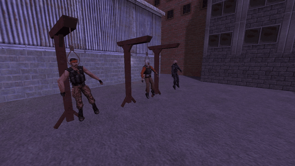

<h1 align="center">Hangman</h1>

<p align="center">
  
</p>

## 📝 Description
This plugin adds a placeable gallows system to Counter-Strike 1.6, giving players an alternative to the usual /kill command.
Players can interact with gallows to hang themselves, with configurable hold duration, cooldowns, death messages and sounds. If Corpse Gore is loaded, hanged corpses can also use its gibbing effects.
- Place and configure gallows around the map
- Support for separate Terrorist and Counter-Terrorist Hangmans
- Customizable death messages, sounds and HUD effects
- Save and load gallows placements per map
- Integrates with Corpse Gore when available

## 📋 Requirements
- ReGameDLL
- AMX Mod X 1.10+

## ⚙️ Configuration
```ini
# To add a new Hangman, follow the example below:
# [Hangman Name]
# HANGMAN_TEAM     = 0 - None   1 - Terrorist   2 - Counter-Terrorist   3 - Both
# HANGMAN_COOLDOWN = Duration in seconds before the Hangman can be used again (MIN MAX)
```

## 🔄 Changelog
```text
* v1.0: Initial release.
```

[](https://www.youtube.com/watch?v=OSoEcBY6dns)
